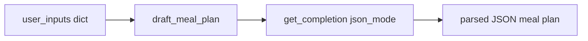

# Wiring `user_inputs` into `meal_plan`

How the meal-planner turns a fixed set of parameters into a JSON dinner
plan: why inputs live apart from the planner, how the prompt uses those
keys, and how the entry point calls everything together.

## Separation of concerns

Two modules, two jobs:

| File | Role |
|------|------|
| `user_inputs.py` | Holds the **what** — people, days, calories, allergens, budget, pantry |
| `meal_plan.py` | Holds the **how** — build prompts, call the model, parse JSON |

Keeping parameters in their own module makes them easy to change (or
later replace with CLI / form input) without rewriting the planning
logic. The planner stays a pure function of whatever dict you pass in.

## Passing a dict into a function

`draft_meal_plan` takes one argument: the `user_inputs` dictionary.

```python
def draft_meal_plan(user_inputs):
    ...
```

Inside the function, f-strings pull values out by key and inject them
into the prompt:

```python
f"""... a family of {user_inputs["people"]} people."""
f"""... around {user_inputs["daily_calories"]} calories ..."""
```

Lists (allergens, pantry) are turned into readable comma-separated
strings with `", ".join(...)` so the model sees plain English, not
Python list syntax.

## Key-name contract

The dict and the prompt must agree on key names. If the dict has
`"budget"` but the prompt reads `user_inputs["total_cost"]`, Python
raises `KeyError` before the model is ever called.

Same idea for days: if `user_inputs` owns `"days"`, the prompt should
use that value instead of hardcoding `"7-day"`. Otherwise changing
`days` in the dict does nothing.

### Before vs after (prompt fixes)

**Before** (broken / rigid):

```python
# Key does not exist on user_inputs → KeyError
user_inputs["total_cost"]

# Days ignored even if you change user_inputs["days"]
"create a 7-day **dinner** plan"
```

**After** (matches the dict):

```python
user_inputs["budget"]

f"create a {user_inputs['days']}-day **dinner** plan"
```

## Prompt construction

Two prompts, two jobs:

1. **System prompt** — who the model should act as (role / tone).
2. **User prompt** — the task: constraints from `user_inputs`, plus the
   JSON schema the reply must match.

Wrapping instructions and schema in tags (`<instructions>`,
`<schema>`) helps the model keep “do this” separate from “shape the
output like this.”

## JSON mode + schema

`get_completion(..., json_mode=True)` asks the API for a JSON object
(no markdown fences). The prompt also includes an explicit
`schema_string` so the shape is clear: a `menu` list of day/dish/
ingredients/calories/cost, plus `total_cost`.

The API still returns a **string**. `json.loads(raw_response)` turns
that string into a Python `dict` you can print, refine, or pass to the
next step in the workflow.

```python
raw_response = get_completion(user_prompt, system_prompt, json_mode=True)
parsed_response = json.loads(raw_response)
return parsed_response
```

## Wiring / entry point

Defining `draft_meal_plan` is not enough — something must import the
inputs and call the function.

In `meal_plan.py`:

```python
from user_inputs import user_inputs
```

Then run the pipeline only when the file is executed directly (not when
another module imports `draft_meal_plan`):

```python
if __name__ == "__main__":
    meal_plan = draft_meal_plan(user_inputs)
    print(json.dumps(meal_plan, indent=2))
```

`if __name__ == "__main__":` keeps import side effects off. Later you
can move the same call into `meal_planner.main()` for the CLI entry
point; the idea is the same: one place that wires inputs → draft →
output.

## Data flow

```text
user_inputs dict
       │
       ▼
draft_meal_plan(user_inputs)
       │  builds system + user prompts
       ▼
get_completion(..., json_mode=True)
       │  returns JSON string
       ▼
json.loads → Python dict (meal plan)
       │
       ▼
print / next workflow step
```



## Checklist

1. Keep parameters in `user_inputs.py`; keep prompting/parsing in
   `meal_plan.py`.
2. Pass the dict into `draft_meal_plan(user_inputs)`.
3. Use the same keys in the prompt as in the dict (`budget`, `days`,
   etc.).
4. Join list fields for readable prompt text.
5. Use JSON mode + a schema, then `json.loads` the reply.
6. Call the function from an entry point (`__main__` or `main()`).
